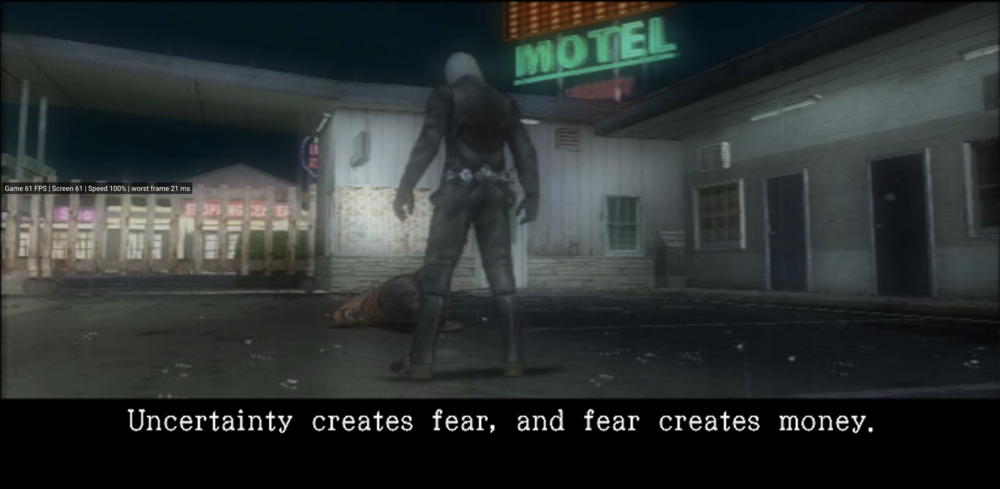
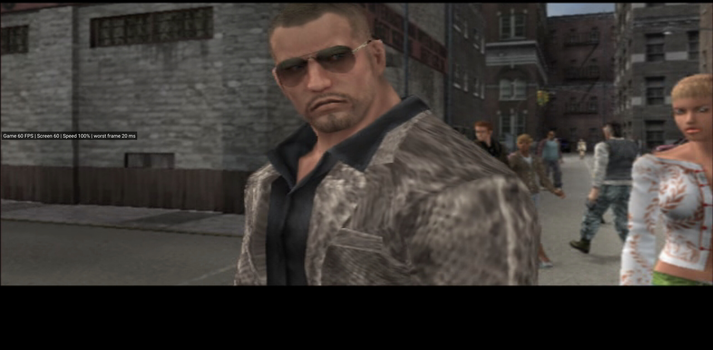
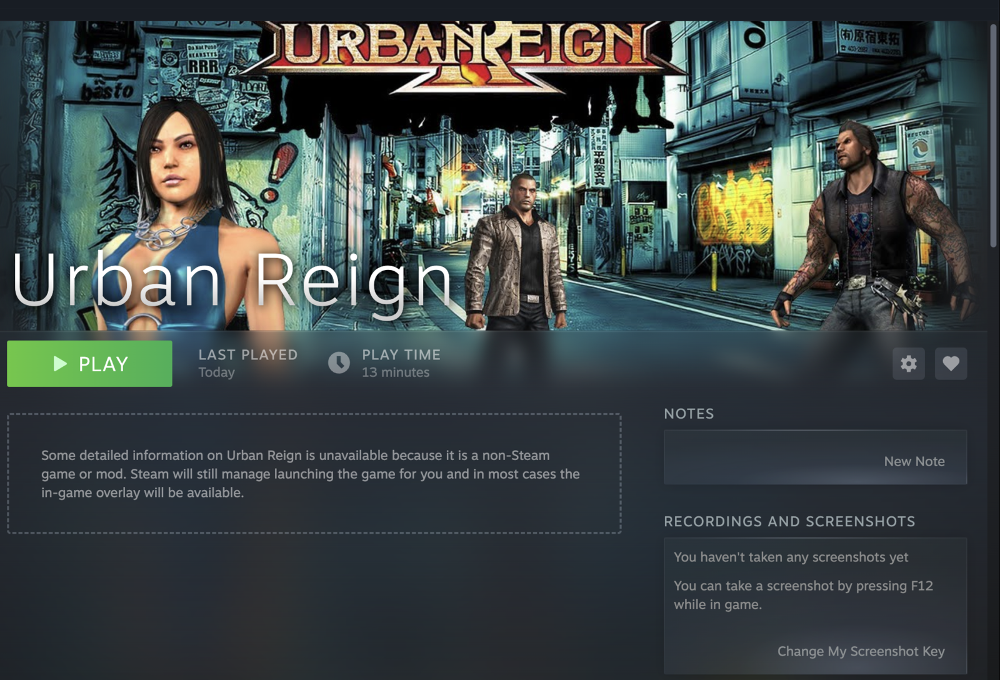

<div align="center">

# Urban Reign — native on Apple Silicon

**The PS2 brawler recompiled into a native arm64 Mac app: 60 FPS, 3× resolution, up to 8 fighters on one Mac —
and friends can join over Steam Remote Play Together.**


[**Build it**](#quick-start-apple-silicon) · [Performance](#60-fps-on-apple-silicon) · [Online co-op](#online-co-op-with-steam-remote-play-together) ·
[Troubleshooting](#troubleshooting) · [How it works](#how-it-works)



</div>

> [!NOTE]
> This is the **macOS / Apple Silicon branch** of [thiagordsfx/urban-reign-recomp](https://github.com/thiagordsfx/urban-reign-recomp).
> That project does the hard part: the Windows/Linux port, the recompiler, the runtime and the game research.
> This branch adds the macOS platform layer — arm64 build, Metal/MoltenVK presentation, app bundle, Steam
> integration and the performance work below. It is meant to go upstream.

> [!IMPORTANT]
> **The game is not included.** You need your own copy of Urban Reign for the PS2 (USA, `SLUS-21209`) as a disc
> image. Nothing from the disc is in this repository.

## What this is

Urban Reign's PS2 code was translated into C++ ahead of time — *static recompilation*, no interpreter and no
emulator front-end — and compiled as a normal Mac program. The game logic runs as native arm64 code; the graphics
chip (GS) is PCSX2's Vulkan renderer running on MoltenVK inside the app's window.

The result is a real `Urban Reign.app`: double-click it (or press **PLAY** in Steam), and you get the game at 60 FPS
in a resizable Mac window, with controllers, memory cards, save states and mods.



## What works on macOS

| | Status |
|---|---|
| Boot, PS2 logo, intro, title, profile menu | Verified on a retail `SLUS-21209` image |
| Missions and fights | Verified (Mission 01), 59 FPS in-fight |
| 60 FPS progressive scan | Verified — see [measurements](#60-fps-on-apple-silicon) |
| Internal resolution up to 3× (1920×1344) at 60 FPS | Verified |
| 16:9 widescreen, 4:3, FXAA, texture filtering, sharpening | Implemented (PCSX2 GS settings) |
| Controllers (SDL3), rumble | Implemented |
| 8-player multitap | Implemented, not tested by us |
| Memory cards, savestates (F5/F9) | Verified |
| Mods: `.dylib` mods and PCSX2 `.pnach` patches | Implemented (CoopTool builds for arm64) |
| HD texture packs (PCSX2 format) | Supported, not tested on this branch |
| Steam overlay + Remote Play Together | Host side verified, guest join not yet |

## Quick start (Apple Silicon)

Requires an Apple Silicon Mac, macOS 14+, the Xcode command line tools and [Homebrew](https://brew.sh/).

```sh
git clone https://github.com/<you>/urban-reign-recomp.git
cd urban-reign-recomp
git checkout macos-arm64

./tools/macos/install_deps.sh          # cmake, ninja, SDL3, shaderc, MoltenVK, Vulkan headers
cp ~/path/to/"Urban Reign (USA).iso" game/
python3 build.py                       # generate game code, build, play
```

`build.py` is a three-step menu: **1** recompiles the game code from your disc (a few minutes), **2** builds the app
(the long part the first time), **3** plays. Non-interactive:

```sh
python3 build.py generate   # recompile the game code from game/*.iso
python3 build.py build      # build build/macos/bin/urban
python3 build.py play       # run it
```

### Make it a double-clickable app

```sh
./tools/macos/make_app.sh
open "build/macos/Urban Reign.app"
```

The bundle is self-contained: binary, `libpcsx2gs.dylib`, MoltenVK, shaderc, resources, mods, memory cards and the
disc image (copied from `game/`). It is ad-hoc signed, which is enough to run locally.

Optional: drop your own `assets/UrbanReign.icns` in the repository root before running `make_app.sh` to give the
bundle an icon. That folder is not tracked (game art is not distributed).

To play under Steam with the overlay, see [Online co-op](#online-co-op-with-steam-remote-play-together).

## 60 FPS on Apple Silicon

The expensive part is not the recompiled game code — it is the VU (vector unit) microcode the game uploads at run
time for geometry and skinning. Interpreting it costs millions of FMACs per frame on the CPU.

The fix is to **capture those microprograms and compile them ahead of time**. Capture is automatic: the app writes
every uploaded VU image to `vu_capture/`. Play the missions and modes you care about once, then:

```sh
python3 build.py aot        # compile every captured image into generated/vu1 and relink
```

Measured on a MacBook Air M4 (16 GB), macOS 27, `InternalResolution=3` (1920×1344 from 640×448):

| Scene | Interpreter | AOT VU library |
|---|---|---|
| Intro / cutscenes | 43 FPS, 80% speed | **57–60 FPS, 97–100%** |
| Mission 01 fight (4 fighters) | ~17 FPS, 83% speed | **59 FPS, 98%** — overlay: `Game 59 · Screen 59 · Speed 98% · worst frame 31 ms` |
| Cutscene, frame overlay | — | `Game 60 · Screen 60 · Speed 100% · worst frame 20 ms` |

`InternalResolution=4` (2560×1792) is sharper but measured ~55 FPS / 91%; 3 is the 60-FPS sweet spot on this
machine, and it is the macOS default. So are `StartMaximized=1`, `FXAA=0` (the 3× image is already clean),
`TextureFiltering=3`, `Sharpening=1` and immediate presentation (`PS2X_PCSX2_VSYNC=0`, one frame of latency).

The capture is per VU program, not per mission: one play session can cover every scene you unlocked. The first
fight loads a different program from the cutscenes, so capture while a fight is on screen.

## Online co-op with Steam Remote Play Together

Steam only offers Remote Play Together for games it knows about, so a non-Steam shortcut gets no invite button.
[`tools/rpt-mac`](tools/rpt-mac) fixes that: it talks to the running Steam client through `steamclient.dylib` and
drives the same remote-play interface the overlay uses, then prints one connect link per friend.

```sh
cd tools/rpt-mac && make

# 1. Add the app to Steam: Games > Add a Non-Steam Game > Browse > your Urban Reign app
# 2. Find the appid Steam assigned to it:
./rptmac apps "Urban Reign"
2511043820	Urban Reign	/Users/you/UrbanReign.app/Contents/MacOS/urban

# 3. Start the game from the Steam library, then:
./rptmac host 2511043820 game 2
https://s.team/remoteplay/connect/9uGCLm
https://s.team/remoteplay/connect/Jb2xQr
```

Each link is for one guest; they open it in Steam or the Steam Link app. Up to 3 guests, as usual for Steam.
`remote-play.command` is the same flow as a double-clickable window.

Notes from testing: the host side, group creation and link generation are verified on macOS (`verify` shows the
interface state, two guests get two distinct links). **Guest joining, streaming quality and controller hand-off
have not been tested yet** — there was no second Steam account available. Treat it as experimental.



Two macOS quirks worth knowing:

- A shortcut whose executable path contains spaces makes Steam fail to spawn it. Point the shortcut at a
  space-free path (for example a symlink such as `~/UrbanReign.app`).
- `~/Downloads` and `~/Desktop` are TCC-protected: a Steam-launched app cannot read a disc image that lives
  there. Keep the image inside the app bundle (`Contents/MacOS/game/`) or in the repository's `game/`.

## Controls

| PS2 | Keyboard |
|---|---|
| ✕ / ○ / □ / △ | ↓ / → / ← / ↑ |
| Left stick | W A S D |
| L1 / R1 / L2 / R2 | Q / E / 1 / 3 |
| L3 / R3 | F / G |
| START / SELECT | Enter / Tab |

| Key | |
|---|---|
| F11 | Fullscreen |
| F3 | FPS/speed overlay |
| F5 / F9 | Quick save / load state |
| F2 | In-game mod menu |
| F4 | Reload `.pnach` patches |

Controllers work out of the box (SDL3); buttons, per-player assignment and the multitap are in the **Controls** tab
of the launcher / `controls.ini`.

## Troubleshooting

| Symptom | Cause and fix |
|---|---|
| `"Urban Reign.app" is damaged and can't be opened` | Quarantine on a downloaded build. `xattr -dr com.apple.quarantine "/Applications/Urban Reign.app"`, or build it yourself. |
| `[CDIMAGE] cannot open ...iso` | The image is unreadable from the sandboxed/TCC-protected folder, or is missing. Copy it into `game/` or the bundle. |
| Game runs but Steam shows nothing / no overlay | Launch it from the Steam library. A shortcut whose path contains spaces can make Steam fail to spawn it (see above). |
| ~17–20 FPS in fights | No AOT VU library yet. Play once, then `python3 build.py aot`. |
| Black window / no picture | Leave `Renderer=pcsx2`. The native OpenGL GS is Windows-only and the software GS is a diagnostic fallback. |
| First run asks to format the memory card | Choose **Yes**; the card is created under `build/macos/bin/memcards/`. |
| `cmake` cannot find MoltenVK/shaderc | Re-run `./tools/macos/install_deps.sh`; CMake copies both dylibs next to `libpcsx2gs.dylib`. |

## Build details

```
tools/macos/install_deps.sh   toolchain and libraries (Homebrew)
tools/macos/check_port.sh     no-disc checks: build, MoltenVK device, raylib + NSView + GS present
tools/macos/make_app.sh       wrap the build into Urban Reign.app (optional icon)
tools/macos/make_release.sh   ZIP for distribution: no image, no saves, no settings
tools/macos/aot_vu.sh         one guided capture session, then the same AOT compile
tools/rpt-mac/                Remote Play Together for non-Steam shortcuts
docs/MACOS.md                 the long version: renderer, verification, limits
```

`python3 build.py release` produces `build/release/urban-reign-macos-arm64.zip` (26 MB, no game data).

### No-disc verification

Two targets prove the graphics plumbing without owning the disc:

```sh
./tools/macos/check_port.sh
# pcsx2_gs_test_mac: MoltenVK device + present
# ps2x_gs_window_smoke: raylib NSWindow + NSView/CAMetalLayer child + GS presents -> "GS window attached: yes"
```

## How it works

```
disc image ──► ps2_recomp ──► generated/*.cpp ──► clang (arm64) ──► urban
                                              │
             PS2 GS packets ──► libpcsx2gs.dylib (PCSX2 Vulkan) ──► MoltenVK ──► CAMetalLayer
             PS2 VU microcode ──► vu1_recomp (AOT) or interpreter
```

- **Recompilation** — the disc's MIPS code becomes C++ (one function per guest address), linked against a small
  PS2 runtime that implements the hardware registers, DMA/VIF, IOP and GS packet path.
- **macOS platform layer** — `runtime/ps2xRuntime/include/runtime/host_thread.h` abstracts threads, Windows-only
  debug tooling is compiled out, and `sse2neon` translates the runtime's SSE intrinsics to NEON.
- **Presentation** — raylib owns the window and input; PCSX2's GS renders into an `NSView`/`CAMetalLayer` child of
  that window (hit testing disabled, so input stays with GLFW/raylib). Shaders go through shaderc, Vulkan through
  MoltenVK.
- **Threading** — IOP and VU1/GS run on their own threads by default, like PCSX2's MTVU.

Everything else — settings, launcher, mods, savestates, the recompiler — is described in
[`docs/ADVANCED.md`](docs/ADVANCED.md).

## Extras

- **HD texture packs** (PCSX2 format): the [Urban Reign Enhanced HD Textures
  Pack](https://gbatemp.net/threads/urban-reign-enhanced-hd-textures-pack-updated.665094/) goes in a `textures`
  folder next to the executable (`build/macos/bin/textures/SLUS-21209/replacements`), or inside the app bundle.
- **Mods**: `.dylib` mods and PCSX2 `.pnach` patches live in `mods/`; the **CoopTool** that ships with the port
  builds for arm64 and adds up to 8 fighters locally. Its options are in the in-game menu (**F2**).
- **Your own mods**: the [mod kit](modsdk/README.md).

## Port status map

Every Sony SDK library and PS2 hardware component the game links, colored by status — click for the details.

<a href="docs/status/details.en.md"></a>

## Limits

- The native OpenGL GS backend is not ported; PCSX2/Vulkan is the supported renderer.
- Windows-only tools (native profiler, F10 combat capture, hardware watchpoints) are compiled out.
- The app is ad-hoc signed. Distributing it needs a Developer ID signature and notarization.
- 8-player multitap, HD texture packs and guest-side Remote Play Together are implemented but untested here.
- The launcher UI is still the Windows/Linux one: the macOS build opens the game directly.

## Other platforms

The upstream project ships Windows x64 and Linux x86-64 builds with the same feature set; this branch does not
change them. Windows/Linux downloads, the launcher, release packaging and the full documentation live in
[thiagordsfx/urban-reign-recomp](https://github.com/thiagordsfx/urban-reign-recomp) and
[`docs/ADVANCED.md`](docs/ADVANCED.md), [`docs/LINUX.md`](docs/LINUX.md).

## Credits

- **[thiagordsfx](https://github.com/thiagordsfx)** — the Urban Reign PC port this branch extends.
- **[PS2Recomp](https://github.com/ran-j/PS2Recomp)** — recompiler and runtime.
- **[PCSX2](https://pcsx2.net/)** — GS renderer. **MoltenVK**, **SDL3**, **raylib**, **sse2neon**, **shaderc**.
- [Shadow of the Colossus PC port](https://github.com/LightVelox/sotc-vibe-pc),
  [God of War PS2 recomp](https://github.com/KIexster/god-of-war-recomp),
  [Ace Combat 5 static recompilation](https://github.com/sal063/Ace-Combat-5-Static-recompilation),
  Michael's "Force Progressive Scan" patch.
- [remoteplayforever](https://github.com/KayZedd/remoteplayforever) and
  [RemotePlayWhatever](https://github.com/m4dEngi/RemotePlayWhatever) — the Remote Play Together approach used by
  `tools/rpt-mac`.

*Urban Reign* © Namco / Paradigm Entertainment. Fan project, not affiliated with or endorsed by Bandai Namco.
No game files are distributed; screenshots show the game running from a retail copy.

Code is **GPL-3.0** — see [`LICENSE`](LICENSE).
